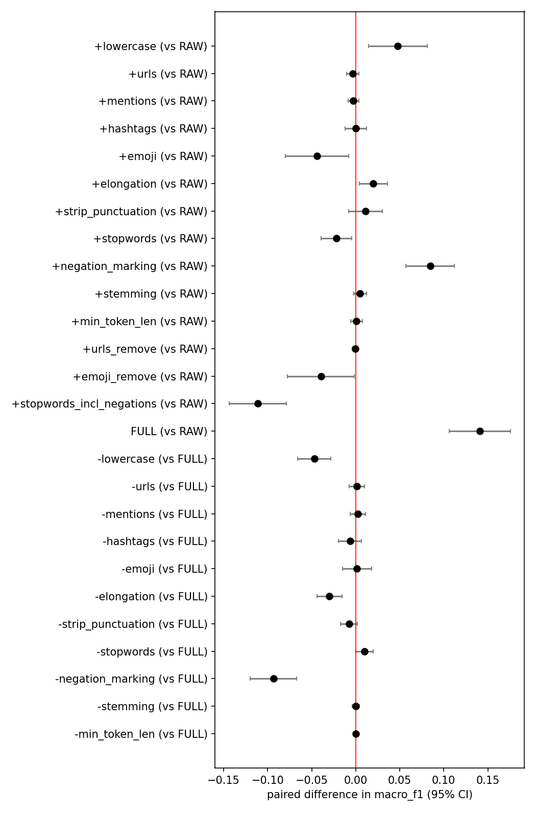

# Preprocessing ablation report

> **SYNTHETIC DATA - for demonstration only. These numbers say nothing about real-world behaviour and must not be reported as findings.**

## Setup
- data: `synthetic(n=1200, seed=0)` (sha256 `0d4d74da54f211f3...`), 1120 rows after cleaning
- design: both; models: logreg; 2x5-fold stratified CV; seed 42
- primary metric: macro_f1; comparisons use the Nadeau-Bengio corrected resampled t-test with Holm adjustment
- scikit-learn 1.8.0, python 3.12.3, commit None

## Data audit (before cleaning)
- rows: 1362 (empty after normalisation: 12)
- labels: {0: 757, 1: 605} (positive rate 0.444, imbalance ratio 1.25)
- exact duplicate rows: 108; redundant rows after normalisation: 207
- rows in label-conflicting duplicate groups: 48 (23 groups)
- tokens per text: mean 8.6, median 8, p95 15
- noise: URL 19.2%, mention 24.1%, hashtag 25.0%, emoji 38.8%, elongation 26.3%, non-ASCII 38.8%

## Scores per pipeline
| model | config | macro_f1_mean | macro_f1_std | roc_auc_mean | n_features_mean |
|---|---|---|---|---|---|
| logreg | RAW | 0.7894 | 0.0209 | 0.8732 | 931.3000 |
| logreg | +lowercase | 0.8372 | 0.0185 | 0.9040 | 713.9000 |
| logreg | +urls | 0.7860 | 0.0200 | 0.8706 | 985.3000 |
| logreg | +mentions | 0.7867 | 0.0191 | 0.8708 | 902.4000 |
| logreg | +hashtags | 0.7895 | 0.0181 | 0.8742 | 892.0000 |
| logreg | +emoji | 0.7453 | 0.0226 | 0.8475 | 912.5000 |
| logreg | +elongation | 0.8094 | 0.0201 | 0.8886 | 890.7000 |
| logreg | +strip_punctuation | 0.8006 | 0.0230 | 0.8821 | 861.7000 |
| logreg | +stopwords | 0.7675 | 0.0217 | 0.8522 | 829.4000 |
| logreg | +negation_marking | 0.8740 | 0.0097 | 0.9284 | 1110.7000 |
| logreg | +stemming | 0.7942 | 0.0203 | 0.8757 | 914.7000 |
| logreg | +min_token_len | 0.7902 | 0.0200 | 0.8742 | 926.3000 |
| logreg | +urls_remove | 0.7888 | 0.0206 | 0.8732 | 952.7000 |
| logreg | +emoji_remove | 0.7498 | 0.0254 | 0.8523 | 880.7000 |
| logreg | +stopwords_incl_negations | 0.6780 | 0.0291 | 0.7514 | 791.6000 |
| logreg | FULL | 0.9304 | 0.0109 | 0.9487 | 671.3000 |
| logreg | -lowercase | 0.8833 | 0.0211 | 0.9368 | 772.6000 |
| logreg | -urls | 0.9318 | 0.0111 | 0.9487 | 625.3000 |
| logreg | -mentions | 0.9327 | 0.0125 | 0.9503 | 707.9000 |
| logreg | -hashtags | 0.9241 | 0.0145 | 0.9490 | 706.8000 |
| logreg | -emoji | 0.9318 | 0.0170 | 0.9478 | 722.7000 |
| logreg | -elongation | 0.9006 | 0.0183 | 0.9385 | 688.2000 |
| logreg | -strip_punctuation | 0.9227 | 0.0154 | 0.9490 | 723.8000 |
| logreg | -stopwords | 0.9404 | 0.0134 | 0.9482 | 648.7000 |
| logreg | -negation_marking | 0.8368 | 0.0222 | 0.9132 | 589.7000 |
| logreg | -stemming | 0.9304 | 0.0117 | 0.9476 | 685.3000 |
| logreg | -min_token_len | 0.9304 | 0.0109 | 0.9487 | 671.3000 |

## Effect of each step on macro_f1 (variant minus baseline)
| model | config | baseline | mean_diff | ci_low | ci_high | p | p_holm |
|---|---|---|---|---|---|---|---|
| logreg | +lowercase | RAW | 0.0479 | 0.0147 | 0.0810 | 0.0097 | 0.1949 |
| logreg | +urls | RAW | -0.0033 | -0.0102 | 0.0036 | 0.3034 | 1.0000 |
| logreg | +mentions | RAW | -0.0027 | -0.0088 | 0.0034 | 0.3461 | 1.0000 |
| logreg | +hashtags | RAW | 0.0001 | -0.0123 | 0.0126 | 0.9805 | 1.0000 |
| logreg | +emoji | RAW | -0.0440 | -0.0798 | -0.0082 | 0.0213 | 0.3646 |
| logreg | +elongation | RAW | 0.0201 | 0.0043 | 0.0358 | 0.0182 | 0.3458 |
| logreg | +strip_punctuation | RAW | 0.0113 | -0.0078 | 0.0303 | 0.2135 | 1.0000 |
| logreg | +stopwords | RAW | -0.0219 | -0.0395 | -0.0043 | 0.0203 | 0.3646 |
| logreg | +negation_marking | RAW | 0.0847 | 0.0571 | 0.1122 | 0.0001 | 0.0015 |
| logreg | +stemming | RAW | 0.0048 | -0.0024 | 0.0121 | 0.1673 | 1.0000 |
| logreg | +min_token_len | RAW | 0.0008 | -0.0058 | 0.0075 | 0.7872 | 1.0000 |
| logreg | +urls_remove | RAW | -0.0005 | -0.0041 | 0.0030 | 0.7348 | 1.0000 |
| logreg | +emoji_remove | RAW | -0.0396 | -0.0777 | -0.0015 | 0.0433 | 0.6933 |
| logreg | +stopwords_incl_negations | RAW | -0.1113 | -0.1437 | -0.0789 | 0.0000 | 0.0007 |
| logreg | FULL | RAW | 0.1410 | 0.1063 | 0.1758 | 0.0000 | 0.0002 |
| logreg | -lowercase | FULL | -0.0471 | -0.0661 | -0.0282 | 0.0003 | 0.0071 |
| logreg | -urls | FULL | 0.0014 | -0.0073 | 0.0100 | 0.7273 | 1.0000 |
| logreg | -mentions | FULL | 0.0023 | -0.0065 | 0.0111 | 0.5692 | 1.0000 |
| logreg | -hashtags | FULL | -0.0063 | -0.0194 | 0.0067 | 0.3003 | 1.0000 |
| logreg | -emoji | FULL | 0.0014 | -0.0150 | 0.0179 | 0.8481 | 1.0000 |
| logreg | -elongation | FULL | -0.0298 | -0.0440 | -0.0156 | 0.0010 | 0.0218 |
| logreg | -strip_punctuation | FULL | -0.0077 | -0.0173 | 0.0018 | 0.0999 | 1.0000 |
| logreg | -stopwords | FULL | 0.0100 | 0.0002 | 0.0199 | 0.0464 | 0.6957 |
| logreg | -negation_marking | FULL | -0.0936 | -0.1199 | -0.0672 | 0.0000 | 0.0005 |
| logreg | -stemming | FULL | -0.0000 | -0.0040 | 0.0040 | 0.9931 | 1.0000 |
| logreg | -min_token_len | FULL | 0.0000 | 0.0000 | 0.0000 | 1.0000 | 1.0000 |

## How to read this
- `+step`: RAW plus that single step. `-step`: FULL pipeline without that step.
- Differences whose CI includes 0 (or p_holm >= 0.05) are not evidence of an effect.
- One dataset and a handful of models: treat findings as exploratory.
